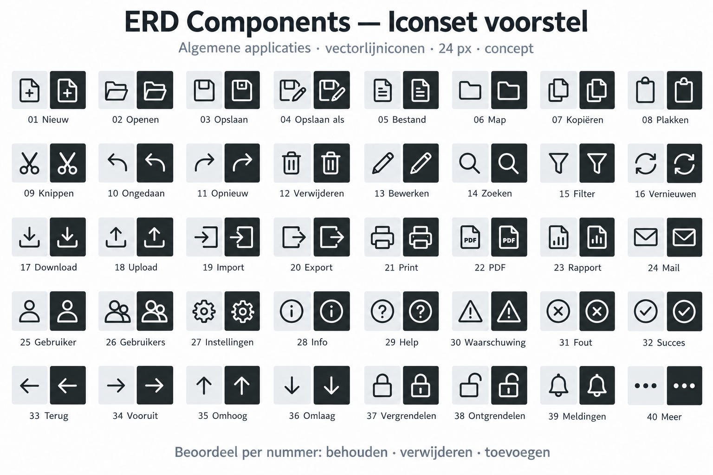
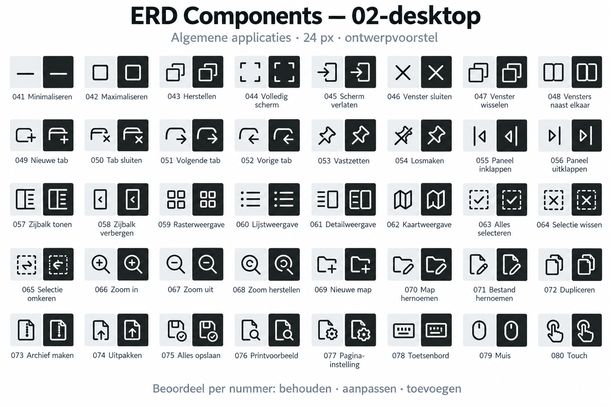
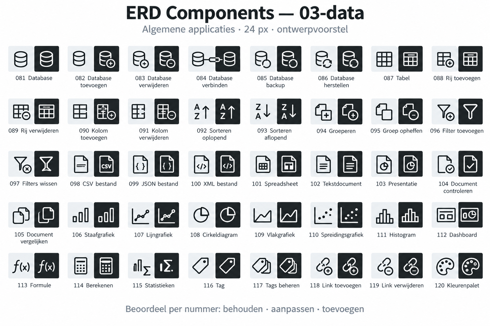
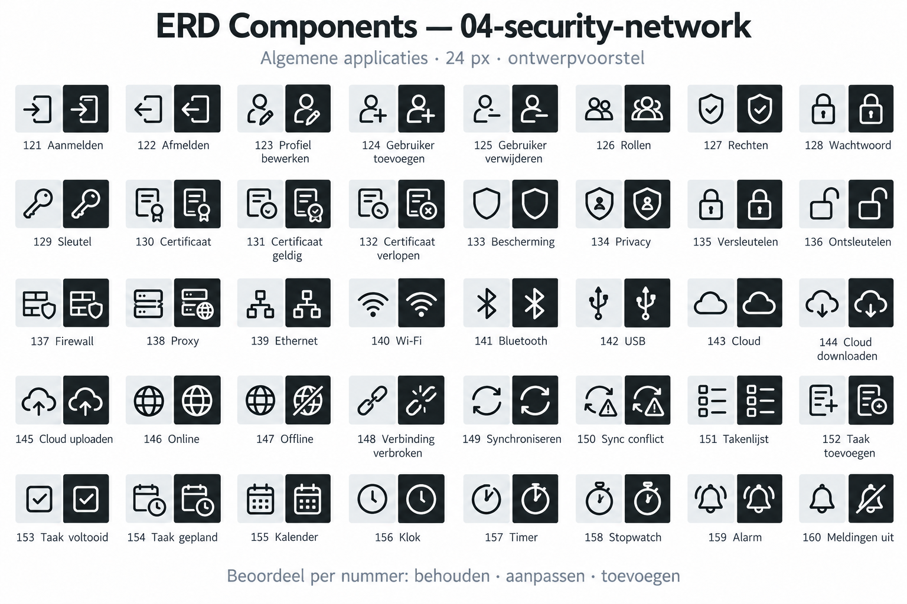
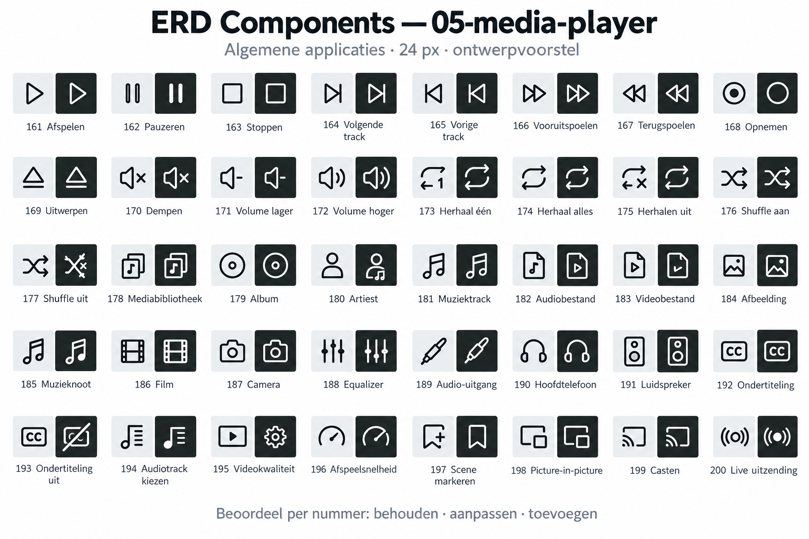
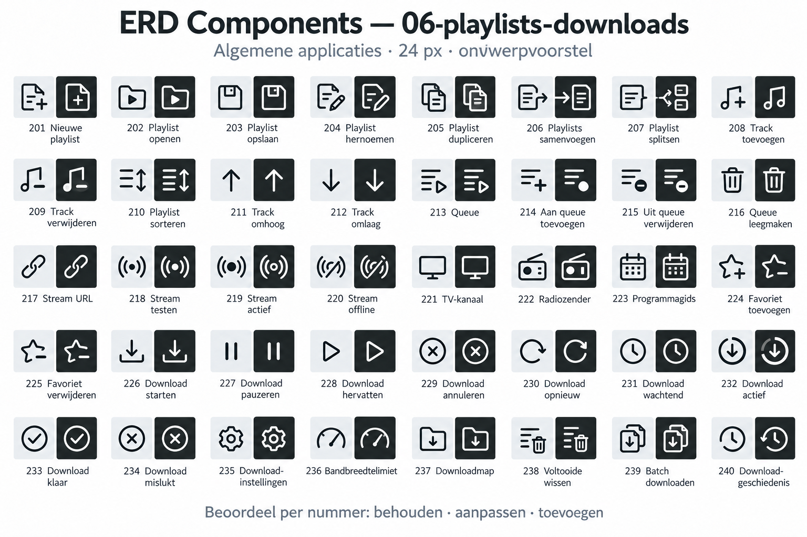
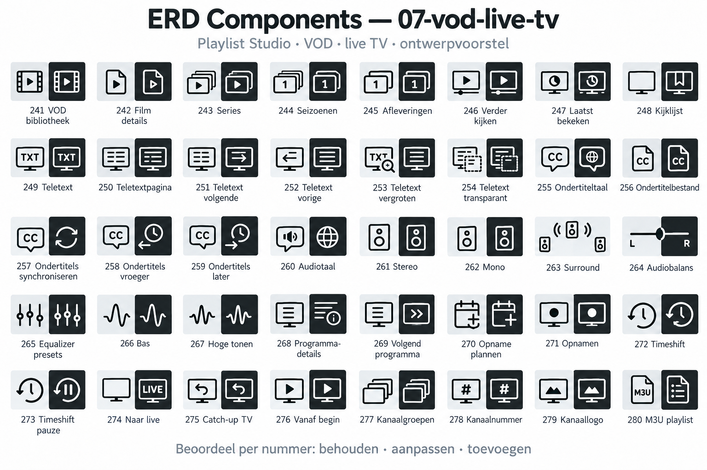
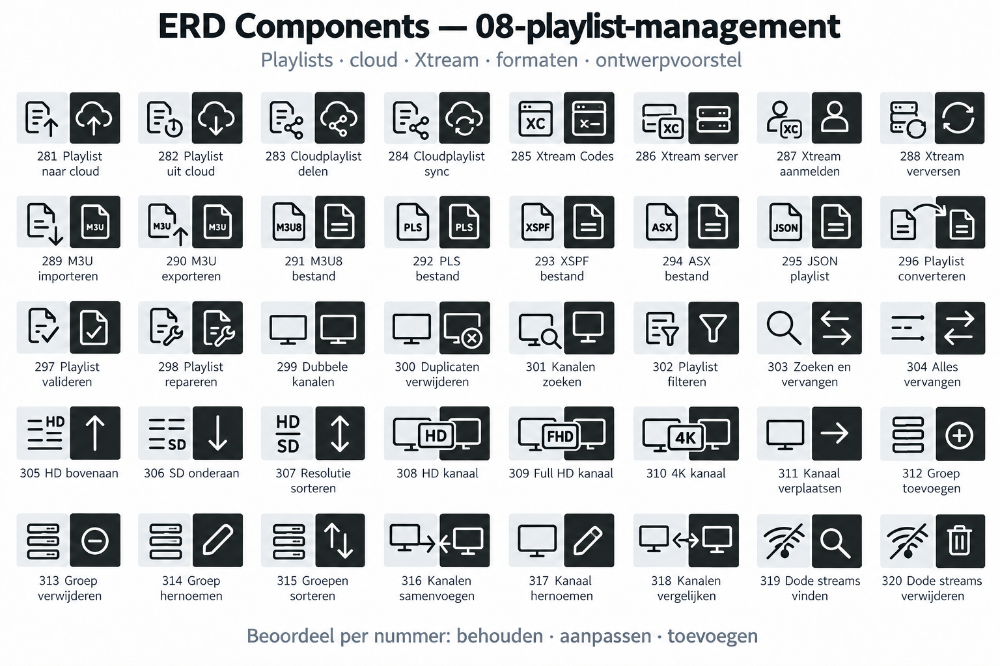

# ERD Components — iconsetreview

Voorstel voor **320 algemene applicatie-iconen**, verdeeld over acht bladen van
40. Elk concept wordt op een lichte en donkere achtergrond getoond. De eerste
40 behouden hun nummers. **160 iconen zijn specifiek voor media, players,
playlists, streams en downloadbeheer.**

Dit zijn visuele ontwerpvoorstellen, geen definitieve vectorassets. Bij de
implementatie worden vormen gecontroleerd, licht/donker gelijkgetrokken en
waar nodig onduidelijke symbolen aangepast. Formaten en kleurvarianten tellen
niet als extra iconen.

[Volledige catalogus met nummers en namen](iconset-catalog.md) ·
[Machineleesbare catalogus](iconset-catalog.json)

Geef per nummer aan wat behouden, verwijderd of aangepast moet worden en welke
iconen ontbreken. De definitieve integratie in de componenten volgt na review.

## 001–040 — Basisacties

## 041–080 — Vensters, navigatie en bestanden

## 081–120 — Data, grafieken en documenten

## 121–160 — Accounts, netwerk en taken

## 161–200 — Media en player

## 201–240 — Playlists, streams en downloadbeheer

## 241–280 — VOD, live TV en IPTV

## 281–320 — Playlistbeheer, cloud en formaten

