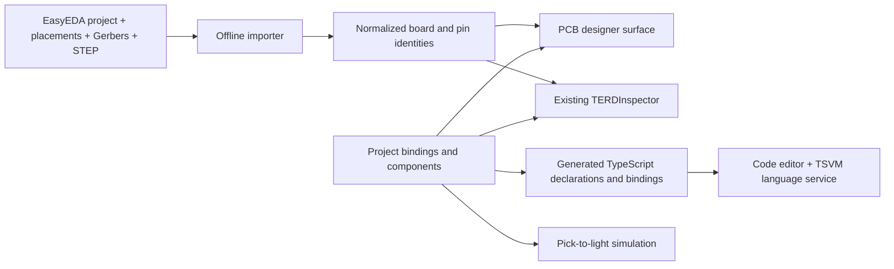

# Pick-to-light PCB designer plan

This document retains the original IDE roadmap and records the reusable designer
baseline below. The canvas, editable scene, templates, component registry,
standalone inspector adapter and grouped property editing are implemented.
Pick flows, TypeScript bindings, simulation and device execution remain deferred
by the user's scope decision. They are not acceptance criteria for this component
baseline.

## What the supplied board files contain

The EasyEDA Pro `.epro` is a ZIP container with a `project.json`, two schematic
sheets, a PCB document, footprints and symbols. Its PCB uses line-delimited JSON
records (`DOCTYPE PCB 1.8`). It contains 135 component records, 496 pad/net
assignment records and 116 net records, including the empty/unassigned net.
The pick-and-place export independently lists 135 components. Both CSV exports
are UTF-16, tab-separated files despite their `.csv` extension.

The BOM identifies an ESP32-S3-WROOM-1-N8 (`U6`), a CP2102N USB/UART bridge
(`U5`), seven SN74AHCT125 buffers, 28 three-pin output terminals, two buttons,
a status LED and an onboard WS2812B LED. The STEP model is an EasyEDA Pro
mechanical export with board/copper shapes and some named component assemblies.
The Gerber archive has outline, copper, mask, silkscreen and drill layers.

Use the EasyEDA project for electrical identity and connectivity, placements for
cross-checking transforms, Gerbers for an accurate board picture, and STEP for a
later 3D view. Do not infer electrical function from a STEP mesh or pad colour.
Do not assume the STEP export from September 22 exactly matches the electrical
and manufacturing exports from September 23; compare references and positions.

A verified example from the pad-net records:

| Physical point | Meaning |
| --- | --- |
| U6 pin 4 | GPIO4 |
| U9 pin 2 / pin 3 | GPIO4 input / buffered output `$2N705` |
| R17 pin 1 / pin 2 | `$2N705` / `OUT_GPIO4` |
| U7 pin 1 / pin 2 / pin 3 | 12V / OUT_GPIO4 / GND |
| SW1 | GPIO0 to GND: boot-related input |
| SW2 | CHIP_PU to GND: reset |

There are 28 terminal signal nets named `OUT_GPIO…`. Their terminal signal is
pin 2, with 12V on pin 1 and GND on pin 3. These are buffered output channels,
not arbitrary bidirectional GPIO terminals. In particular, SW1 and SW2 must not
silently become generic application buttons. Resolve MCU pad numbers, GPIO
identities, buffer paths and reserved functions from symbols and connectivity.

## Later IDE workflow (deferred)

Start with a faithful top-down board view, with top/bottom switching, zoom,
pan, fit-to-board, component labels and selectable pin/pad overlays. This keeps
selection precise and the Windows VM responsive. Add a 3D inspection mode later
using the same identities and selection model; 3D is not a prerequisite for
assigning actions.

The first complete workflow is:

1. Open this board and select the U7 signal pin or its logical output channel.
2. The inspector shows U7.2, OUT_GPIO4, GPIO4 and its buffer path as physical facts.
3. Name the channel, assign a WS2812 output component, set its LED count and
   bind a typed action such as `showPick`.
4. Preview that action in simulation and navigate to its TypeScript handler.
5. Save, close and reopen with the same board selection and assignments intact.
6. Compile the project through TSVM; display diagnostics in both the inspector
   and code editor. Actual device connection/deployment is a separate command.

## Proposed architecture

Suggested new units/components, subject to implementation review:

- A board document model holding components, pads, nets, capabilities and stable
  source identifiers. Keep physical board facts separate from user assignments.
- `TERDPCBDesigner`: a custom-painted canvas with spatial hit testing, hover,
  keyboard selection, zoom and pan. Avoid one Windows child control per pin.
- An inspector adapter for the existing `TERDInspector`, observing selection
  through a shared selection model rather than modifying the canvas directly.
- A project component collection for nonvisual objects and their typed properties,
  events and references. A component tray and project tree expose these objects.
- A command stack for property changes, bindings, component creation and deletion;
  the inspector, tray and canvas all use the same undo/redo commands.

## Delivery stages

### 1. Import and normalize the real board

Read the EasyEDA archive as data, resolve component footprint/symbol references,
transform footprint-local pad coordinates into board coordinates, and join
component IDs with pad numbers and net assignments. Keep anonymous net IDs as
identities even when display names change. Coalesce repeated exposed-pad numbers
for electrical assignment while retaining their separate selectable shapes.

Normalize to millimetres using verified placement pairs. The PCB `CANVAS` display
unit alone is insufficient: for example C1's coordinate 1050 corresponds to
26.67 mm in the placement export, implying a 0.0254 conversion for that coordinate.
Verify rotation, Y direction, component origins and bottom-side mirroring against
multiple asymmetric reference points before enabling assignments.

Output a versioned board package containing metadata, lightweight layer artwork,
pad polygons and electrical connectivity. Keep STEP tessellation outside the IDE
runtime; FreeCAD/Open Cascade can convert it into an optional cached mesh asset.

Acceptance: 135 placements reconcile, all 28 output connectors resolve their
three pads, and U7.2 traces through R17/U9 to U6 GPIO4. Unknown or unmapped pins
remain explicitly unresolved rather than being guessed.

### 2. Board canvas and selection

Render board outline, silkscreen, connectors and component bodies with selectable
pad overlays. Cache static layers; repaint selection overlays independently.
Use a spatial index and screen-space hit tolerance, prioritizing a pin over its
component body. Support top/bottom view, pin names on hover, search by connector,
net or GPIO, and synchronized project-tree/inspector selection.

Acceptance: the same pin is selected after zooming, panning and changing view;
rotated connectors and overlapping exposed pads work; selection stays smooth in
the Windows VM. A virtualized scene handles the board without hundreds of HWNDs.

### 3. Inspector bindings and nonvisual components

Separate immutable facts (reference, physical pin, net, routed GPIO, direction)
from editable project properties (name, output driver, LED count, action and
handler). Offer only component types compatible with the board path. Display
power, ground, reset and reserved interfaces as such, not configurable outputs.

Provide reusable actions, WS2812 output groups, timers, debouncers, counters and
pick-location objects in the component tray. A pin can reference an existing
object; do not duplicate that object for each assignment. Validate references,
duplicate ownership and incompatible pin modes as the user edits.

Acceptance: selecting U7.2 updates the inspector; creating and assigning a named
output component is undoable; invalid assignments have an actionable explanation.

### 4. Project storage and TypeScript integration

Save bindings in readable, versioned JSON with stable board/component/pin IDs,
source fingerprints and schema migration. Keep project state separate from
imported geometry. Generate a dedicated TypeScript module for declarations and
binding glue; preserve user-authored handlers in separate files. Generate source
mapping so a compiler diagnostic can select its related pin or component.

Double-clicking an event opens or creates its handler in the code editor. Provide
a typed board API so TSVM completion, signatures and diagnostics know channel
names and component properties. Confirm TSVM's ESP32-S3/WS2812 runtime APIs before
choosing concrete generated imports; do not invent a GPIO/LED runtime interface.

Acceptance: save/load preserves references and undoable properties; regeneration
does not overwrite handler bodies; incompatible handler types produce diagnostics.

### 5. Pick-to-light simulation, then device integration

Model pick requests, output colour/pattern, LED count, acknowledgement and timeout
as testable project behaviour. Simulate inputs and timers and display output state
on the board. Keep simulation state separate from editable configuration.

Then connect to the real TSVM device protocol, with explicit connect/run/stop and
observable device errors. Do not assume the firmware transport from the USB/UART
bridge alone; identify the actual TSVM deployment and command protocol first.

Acceptance: run a pick scenario on U7 without hardware; map an output update back
to the selected channel; then run the same scenario through a connected device.

### 6. Optional 3D mode and larger IDE features

Load preconverted STEP geometry, preserve reference/pin metadata, and synchronize
2D/3D selection. Add multi-board projects, reusable board profiles and live channel
monitoring after the first board-to-code workflow is reliable. Keep the board and
binding model independent of either renderer.

## Implemented reusable component baseline (2026-10-15)

The demo's PCB designer uses the actual imported top-side geometry: 135 component
references, 496 pads/vias and 28 verified buffered WLED outputs. Assembled bodies,
terminals and their contacts are rendered. A three-contact output terminal is one
logical selection; fixed MCU, power and reserved pins are not programmable.

The component baseline now includes:

- Cached antialiased board artwork, theme colors, zoom, fit, grab/hand panning and
  scrollbars that appear only when content extends beyond the viewport.
- Template storage and a separate browser/importer. Templates identify selectable
  outputs, terminal groups and protocol capabilities, including UART/CAN/I2C/SPI.
- Fixed-size nonvisual glyphs with names underneath; resizable multiline notes
  with None, Info, Warning, Error and Question styles.
- Toolbox drag/drop and click-to-place, previews, repeated placement, selection,
  rubberband selection, locks, alignment, distribution and snapping guides.
- Antialiased curved connections, obstacle detours, line/endpoint selection,
  disconnect/reconnect and transfer, pin ownership validation, hints and focus.
- A process-wide component registry with stable type IDs, icons, default values,
  described custom properties and host validation/custom icon callbacks.
- A standalone inspector adapter: typed editors, categories, validation feedback,
  individual/per-type reset and common-property multi-selection editing. Mixed
  values are display state; group edits validate the complete candidate scene
  and apply with one change notification and one undo step.
- Versioned project JSON, embedded DFM geometry/scene data, clipboard operations,
  dirty snapshots without transient selection, and shared undo/redo history.

The user reported Windows testing of commit `f3b37297` as successful and authorized
continued finalization. This is the recorded manual feedback; individual matrix
entries and an automated Windows smoke-run log were not supplied. The cloud can
run importer/library tests and static Pascal checks, but has no Delphi/VCL runtime.
See [Windows checks](pcb-designer-windows-checks.md) for repeatable verification.

The finalization review additionally hardens undo/redo: rejected historical
snapshots preserve both the current scene and its history, and successful change
listeners observe the completed history state.

## Component scope and later work

Keep this baseline stable while addressing concrete regressions. The designer
owns its scene and interaction; the toolbox and inspector remain host controls.
See the [component guide](pcb-designer-component.md) and
[host API guide](pcb-designer-api.md) for the implemented contracts, and
`demo/pcb/README.md` for import instructions.

The original staged architecture above remains a future roadmap. Bottom-side
view/import, a copper/Gerber display, spatial search/project-tree navigation,
3D, multi-board documents, executable component behavior, pick-flow simulation,
TypeScript declarations/handlers and device deployment are not implemented by
this baseline. Additional base pin protocols need implementation; registered
subtypes currently reuse an existing base kind's editing and pin rules.

The next IDE phase should be scoped separately. It must not be inferred from the
presence of metadata fields such as timer settings or a recorded action name;
these do not execute hardware or TypeScript.
